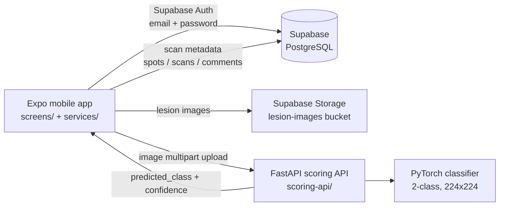

# Skin Cancer Check — Mobile App

A React Native (Expo) prototype that lets a user photograph or upload a skin lesion, sends the image to a FastAPI/PyTorch scoring API, and stores the result — a binary **Low Risk / High Risk** score with a confidence value — in Supabase so it can be tracked over time.

> ⚠️ **Research prototype — not a medical device.** This app has not been clinically validated and must not be used for diagnosis. It was built to explore an end-to-end Medical × AI product flow (mobile capture → model inference → tracked results). Anyone with a skin concern should consult a qualified clinician.

## What it does

- **Capture or upload** a lesion photo (Expo Camera / Image Picker)
- **Score the image** via a remote inference API (`POST /predict`, 224×224 input, softmax over 2 classes)
- **Show the result** with its confidence score and guidance to seek professional review
- **Track history** — scans are linked to body "spots" so changes can be followed over time
- **Learn** — education, skin-care tips, progress statistics, reminders and scheduling screens

## Screenshots

Real simulator/device screenshots still need to be captured — this is tracked in the roadmap below. (The images previously in `Demo/` were not screenshots of this app and have been removed from this README rather than presented as such.)

## Architecture



**How a scan flows**

1. The user signs in with Supabase Auth (`services/AuthService.js`).
2. A photo is taken or picked (`services/ImagePickerService.js`) and sent to the scoring API (`services/ApiService.js`, `services/PredictionService.js`).
3. The API preprocesses the image (resize 224×224, ImageNet normalisation), runs the classifier, and returns `{ predicted_class, confidence, status }` where `0 = Low Risk`, `1 = High Risk`.
4. The result is saved against a spot in Supabase (`spots`, `scans`) and shown on the Results, History and Progress screens.

## Tech stack

| Layer | Technology |
|---|---|
| Mobile app | React Native 0.79, Expo SDK 53, React Navigation 6, React 19 |
| Backend / data | Supabase (PostgreSQL, Auth, Storage) with Row Level Security |
| Inference API | FastAPI, PyTorch / torchvision, Docker (`scoring-api/`) |
| Tooling | EAS build configuration, Python smoke-test scripts |

## Features (as implemented in code)

- Email/password sign-up and sign-in with Supabase Auth (`services/AuthService.js`); on sign-up a matching profile row is created in `public.users` (`id = auth.uid()`)
- 12 screens: Login, Register, Tutorial, Home, Scan, Results, History, Progress, Education, Alert, AI Tips, Schedule (`App.js`, `screens/`)
- Scan history and per-spot tracking with user-isolated queries (`services/PredictionService.js`)
- Progress statistics, educational content, reminders and calendar screens
- Optional demo mode with a mock user (off by default; demo writes are intentionally blocked by RLS — see Security)

## Run it locally

### Prerequisites

- Node.js 20+ and npm
- Expo Go on a device, or an iOS/Android simulator
- A Supabase project (free tier is fine)
- Docker (for the scoring API), or Python 3.9+ to run it directly

### 1. Mobile app

```bash
git clone https://github.com/FOKanu/SkinCancerCheckMobile.git
cd SkinCancerCheckMobile
npm install
cp .env.example .env   # fill in SUPABASE_URL, SUPABASE_ANON_KEY, SCORING_API_URL
npx expo start
```

Configuration is read from `.env` by `app.config.js` and exposed to the app via `expo-constants` (`supabaseClient.js`). Never commit a real `.env` file.

### 2. Scoring API

With Docker, from the repository root:

```bash
docker compose up --build   # serves http://localhost:4000
```

Or directly:

```bash
cd scoring-api
pip install -r requirements.txt
uvicorn app.main:app --host 0.0.0.0 --port 4000
```

Test it:

```bash
curl http://localhost:4000/
curl -X POST http://localhost:4000/predict -F "file=@path/to/lesion.jpg"
# -> {"predicted_class": 0, "confidence": 0.92, "status": "success"}
```

### 3. Supabase setup

Create the tables used by the app (`users`, `spots`, `scans`, `comments`; schema notes in `services/DatabaseService.js`) and **enable Row Level Security with owner-only policies** based on `auth.uid()`:

- `users`: `id = auth.uid()`
- `spots`: `user_id = auth.uid()`
- `scans`: only where the linked spot belongs to `auth.uid()`
- `comments`: `user_id = auth.uid()`

No `anon` policies are required for the app's data tables.

## Project structure

```
SkinCancerCheckMobile/
├── App.js                  # Navigation (12 screens) and app entry wiring
├── screens/                # Login, Register, Scan, Results, History, Progress, ...
├── services/               # AuthService, ApiService, PredictionService,
│                           # DatabaseService, ImagePickerService
├── components/             # Shared UI components
├── supabaseClient.js       # Supabase client (config from expo-constants)
├── app.config.js           # Expo config; reads SUPABASE_* / SCORING_API_URL env vars
├── scoring-api/            # FastAPI + PyTorch inference service (Docker)
│   ├── app/main.py         # GET / and POST /predict
│   └── app/models/         # Classifier definition and checkpoints
├── tests/                  # Python scripts for testing with real skin images
├── docs/                   # API, deployment and development guides
└── .env.example            # Required environment variables (placeholders)
```

## Security

- The Supabase **anon key is a publishable client key** — it is designed to ship in mobile apps. Data protection comes from **Row Level Security**: every table above is restricted to the owning `auth.uid()`, with no anonymous access. This was audited and enabled in 2026; see the Phase 0 log in the portfolio audit.
- The **service_role key is never used in this codebase** and must never be committed or shipped in the app.
- Real credentials live only in `.env` (git-ignored). An earlier hard-coded key was removed from the codebase in commit `7de046b`; because this repository is public, that publishable key is treated as known and is safe only because of the RLS policies above.

## Model

- Binary classifier (2 output classes) served with PyTorch; input is resized to 224×224 and normalised with ImageNet statistics (`scoring-api/app/main.py`).
- The checkpoint was trained by a project teammate (**Fabian**) and integrated into the API and app by me. Model training is **not** claimed as my own work.
- **No accuracy, sensitivity or specificity figures are published here**, because no reproducible evaluation on a held-out dataset exists in this repository. Publishing unverified medical metrics would be irresponsible.
- Known model-code issue: `main.py` instantiates a MobileNetV3 classifier while loading a checkpoint file named `efficientnet_b3_model.pth`, and the two committed checkpoints are byte-identical duplicates. Checkpoint provenance/naming needs cleanup before the API is relied on (see roadmap).

## Testing

Current state, honestly: there is **no automated mobile test suite yet**. Testing so far:

- `scoring-api/test_api.py` — smoke script for the API endpoints
- `tests/test_real_skin_images.py` — prediction script against real skin images
- Manual testing of the main flows (auth, scan, results, history)

## Known limitations

- Not clinically validated; no dermatologist review, no evaluation on a recognised benchmark (e.g. ISIC) in this repo
- Results are a single binary score — no lesion-type classification, no uncertainty explanation, no referral workflow beyond on-screen guidance
- Demo mode uses a fake local user; its database writes are blocked by RLS by design
- Some screens (AI Tips, Schedule) are functional UI but rely on limited/local data rather than a dedicated backend service

## Roadmap

- [ ] Capture real app screenshots and a short demo recording for this README
- [ ] Resolve the checkpoint architecture/naming mismatch and document the trained model properly
- [ ] Add a reproducible evaluation (held-out test set, confusion matrix) before quoting any metric
- [ ] Add automated tests (Jest for services, API integration test in CI)
- [ ] Fix remaining result-handling edge cases and add CI (lint + tests on push)

## My role

Lead developer for the mobile app and integrations (primary author of this repository): navigation and screens, Supabase Auth/database integration, scoring-API integration, environment/security hardening, and this documentation. This was a team project — see acknowledgements.

## Acknowledgements

- **Fabian** — trained the skin-lesion classifier checkpoint used by the scoring API
- **Marten Kose** — team contributions to the project
- Built with Expo, Supabase, FastAPI and PyTorch

## Licence

No open-source licence has been applied to this repository yet. All rights reserved until a licence is added.
